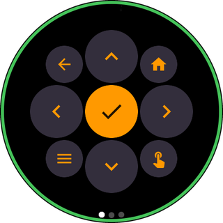
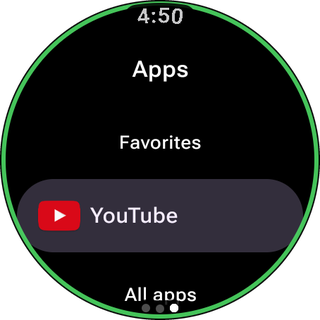
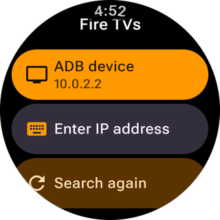

<p align="center">
  
</p>

<h1 align="center">Fire TV Remote for Wear OS</h1>

<p align="center">
  Control your Amazon Fire TV from your wrist. No phone, no cloud, no telemetry.<br>
  <a href="https://github.com/tholeb/FireTVRemoteForWearOS/releases/latest"><b>Download the latest APK</b></a>
</p>

<p align="center">
  
  
  
</p>
<p align="center">
  
  
  
</p>
<p align="center"><sub>Screenshots from the Wear OS 7 emulator controlling an Android TV 11 emulator (the Fire OS 8 base).</sub></p>

## About

Fire TV Remote is a standalone Wear OS app that turns your watch into a full remote for an
Amazon **Fire OS** Fire TV. It talks to the TV directly over your local Wi-Fi using
**ADB over TCP**, the same debugging channel developers use, so it needs no companion phone
app, no account and no internet connection.

After connecting, the watch starts a tiny helper on the TV that injects key presses directly,
so a key press reaches the TV in **about 10–15 ms** instead of half a second. Built for the
Samsung Galaxy Watch on Wear OS 7; it runs on any watch with Wear OS 5 (API 34) or newer.

## Features

- **Remote**: D-pad, OK, Back, Home and Menu, with shortcut keys in the grid corners.
- **Media keys**: Play/Pause, Rewind, Fast-forward, Volume ± and Mute (volume over
  HDMI-CEC; can be hidden if your TV's sound is IR-only).
- **App launcher**: your installed apps and popular streaming apps (Netflix, Prime Video,
  YouTube…) with their real icons and names, sorted by name. Long-press to pin a favourite.
- **Touchpad mode**: swipe to move, tap for OK, hold for Back.
- **Text input**: type or dictate on the watch and send it to the focused field on the TV.
- **Bezel / crown**: moves the focus up and down, or controls the volume.
- **Wake TV**: wakes the Fire TV on launch, and only sends POWER if it's really still asleep.
- **Tile and complication**: Back, Play/Pause and Home straight from a tile; open the remote
  from your watch face.
- **Automatic discovery**: finds the TV by mDNS or a local network scan, with manual IP entry
  as a fallback.
- **Battery-friendly**: the connection and Wi-Fi are released when you leave the app or stop
  using it. In the remote, the screen stays on but dims, and turns off after 5 idle minutes.
- **Safe navigation**: Back moves to the previous page and never closes the remote by
  accident (configurable).
- **Secure**: RSA-2048 ADB key, encrypted with a non-exportable Android Keystore key, never
  backed up.
- **Languages**: English and French.

<details>
<summary>All features in detail</summary>

| Feature | Notes |
|---|---|
| D-pad, OK, Back, Home, Menu | Page 1. Shortcut keys sit in the grid corners |
| Play/Pause, Rewind, Fast-forward, Volume ±, Mute | Page 2. Volume only works over HDMI-CEC (see limitations). If your TV's sound is IR-only, turn off **Volume buttons** in Settings: the volume keys disappear and the bezel never changes the volume |
| Back gesture | Back (edge swipe or the watch's Back button) goes to the previous page and never closes the remote; leave with the Home button. **Swipe back can close the app** in Settings restores the usual behaviour |
| App launcher | Page 3. User-installed apps plus popular preinstalled streaming apps (Netflix, Prime Video, YouTube…); other system apps are hidden. Real icons and names (in the TV's language), read from the TV and cached on the watch. Both favourites and other apps are sorted by name. Long-press to pin a favourite |
| Languages | English and French. Follows the watch language, or set it per app in *Settings → Apps → Fire TV Remote → Language* (Wear OS 4+) |
| Bezel / crown | Moves up/down, or controls volume (toggle in Settings). Always volume on page 2, unless volume control is off |
| Settings | Every setting has a short explanation under its name |
| Wake TV | *Wake TV* (Settings) and **Wake TV on launch** (on by default): sends WAKEUP, checks with `dumpsys power`, and sends POWER only if the Fire TV is verifiably still asleep |
| Screen | **Keep screen on in the remote** (on by default): while the remote or touchpad shows, the screen doesn't turn off. After the **watch's own screen timeout** it dims to **Dimmed brightness** (10-100 %, default 30 %) by darkening the picture, which saves power on the AMOLED screen and works on every watch. The first touch or bezel turn only brightens it again. After **5 minutes** without any touch, bezel or key, the screen is no longer held on and turns off as usual (the connection and Wi-Fi are then released). Other screens keep the normal timeout |
| Touchpad mode | Swipe = direction, tap = OK, hold = Back. Open it from the bottom-right corner key |
| Text input | Watch keyboard / voice → focused text field on the TV (ASCII only) |
| Tile | Back, Play/Pause, Home sent straight from the tile; plus an "open remote" button |
| Complication | Opens the remote from the watch face |
| Haptics, connection ring | Ring colours: green = connected, amber = connecting, red = error, grey = idle |
| Discovery | mDNS (`_amzn-wplay._tcp`) plus a /24 scan of port 5555; manual IP as fallback |

</details>

## Requirements

- A Wear OS watch running **Wear OS 5 (API 34) or newer**, on the same Wi-Fi as the TV.
- A Fire TV running **Fire OS** (5.x to 8.x). **Vega OS** Fire TVs (e.g. Fire TV Stick 4K
  Select) are not supported: they have no ADB.

| Fire OS | Android | Status |
|---|---|---|
| **8.x** (e.g. 8.1.8.5) | 11 (API 30) | **Primary target.** Emulator-verified end to end: pairing, keys via injector (10–14 ms), app list, app launch, fallback |
| 7.x | 9 (API 28) | Same code path as Fire OS 8 (shell v2, no `cmd input` → injector). Not run on an emulator |
| 6.x | 7.1 (API 25) | Same path. Not run on an emulator |
| 5.x | 5.1 (API 22) | No shell v2 in adbd: the app falls back to the legacy `shell:` service (exit-code marker, pty echo filtering), and the commands avoid tools missing there (`cmd`, `grep`, `tail`, `cut`, `sha256sum`). Unit-tested only |
| Vega OS | – | Not supported (no ADB) |

## Install

### 1. Prepare the Fire TV (one time)

1. Check it runs **Fire OS**: *Settings → My Fire TV → About*. If the software version reads
   "OS 1.x", it's **Vega OS**, and this app can't work with it.
2. Turn on developer options: *Settings → My Fire TV → About*, then click the device name
   **7 times**.
3. *Settings → My Fire TV → Developer options → **ADB debugging: ON***.
4. Write down the TV's IP address: *About → Network*.
5. Keep the **TV's own remote** nearby. The first connection shows *"Allow USB debugging?"* on
   the TV. Tick **Always allow from this computer** and press **OK**. The watch can't answer
   this prompt for you, because it isn't authorized yet.

### 2. Install the app on the watch (ADB over Wi-Fi)

Download `FireTVRemote-wear-<version>.apk` from the
[latest release](https://github.com/tholeb/FireTVRemoteForWearOS/releases/latest), or
[build it yourself](#build). You need `adb` from the
[Android SDK Platform-Tools](https://developer.android.com/tools/releases/platform-tools).

1. On the watch: *Settings → About watch → Software information → tap **Software version***
   until the watch says developer mode is on. Menu names vary slightly between One UI
   Watch releases.
2. *Settings → Developer options → **ADB debugging** ON*, then **Wireless debugging** ON.
   Make sure the watch is on the same Wi-Fi as the computer.
3. In *Wireless debugging → Pair new device*, the watch shows an IP:port and a code. Then run:

```bash
adb pair WATCH_IP:PAIR_PORT
```

```bash
adb connect WATCH_IP:CONNECT_PORT
```

```bash
adb install -r FireTVRemote-wear-<version>.apk
```

**WSL2 note:** WSL's default NAT network can't reach the watch. Either turn on mirrored
networking (`networkingMode=mirrored` in `%UserProfile%\.wslconfig`) or run Windows'
`adb.exe` (platform-tools for Windows) on the APK.

## Build

You need **JDK 21** and the Android SDK with platform `android-37.0` and build-tools 37.0.0
(Android Studio installs both). Set `sdk.dir` in `local.properties` if Gradle can't find the
SDK. Then run:

```bash
./gradlew :wear:assembleDebug
```

The APK is written to `wear/build/outputs/apk/debug/`. Other useful tasks:

```bash
./gradlew test                  # unit + Robolectric UI tests for every module
./gradlew :wear:lintDebug
./gradlew :wear:assembleRelease # minified; signed with the debug key for sideloading
```

Signed release APKs are built by GitHub Actions; see
[.github/workflows/README.md](.github/workflows/README.md).

## First run

1. Open **Fire TV Remote** and allow **local network** access. This is a runtime permission
   on Wear OS 7.
2. Tap **Find Fire TV**. Pick the TV from the list, or tap **Enter IP address**.
3. Accept the prompt on the TV (see [step 1.5](#1-prepare-the-fire-tv-one-time)). The watch
   shows the key fingerprint so you can compare it with the one the TV displays.
4. Use the remote: swipe left for media keys, then again for apps.

<p align="center">
  
  
  
</p>
<p align="center">
  
</p>
<p align="center"><sub>The fingerprint on the watch must match the one on the TV. Tick "Always allow", then Allow.</sub></p>

## Troubleshooting

| Message on the watch | Fix |
|---|---|
| Watch Wi-Fi unavailable | Turn on Wi-Fi on the watch and join the TV's network. Turn off airplane / power-saving mode |
| TV not reachable | Check the IP (*TV → About → Network*). TV awake? Same network (no guest Wi-Fi / client isolation)? |
| Connection refused | ADB debugging is off on the TV. Turn it on again (Fire OS updates sometimes switch it off) |
| No answer from the TV | The prompt timed out (45 s) or nobody saw it. Retry while watching the TV |
| The TV refused the connection | "Allow" wasn't chosen. Retry and allow. If you ticked "Always allow" earlier, *Developer options → Revoke USB debugging authorizations* on the TV resets it |
| Failed: Only plain ASCII text… | `input text` can't type accents or emoji |
| Discovery finds nothing | Use **Enter IP address**. mDNS is often blocked on mesh / enterprise Wi-Fi |
| Volume / mute keys do nothing | Your TV or soundbar isn't controlled over HDMI-CEC (common on older TVs with IR remotes). Turn off *Settings → Volume buttons* |
| The app closes when swiping right | Turn off *Settings → Swipe back can close the app* (off by default) |
| The Fire TV wakes but the TV screen stays black | The Fire TV turns the TV on through HDMI-CEC. Turn it on on both: Fire TV *Settings → Display & Sounds → HDMI CEC Device Control*, and on the TV (Samsung: *Anynet+ (HDMI-CEC)*). Older TVs without CEC have to be switched on with their own remote |
| "The Fire TV is still asleep" | The Fire TV ignored both WAKEUP and POWER, or is in a deep sleep that drops the network. Wake it once with its remote |

## Known limitations

- **Vega OS Fire TVs are not supported** (no consumer ADB).
- **The fast-input injector uses an internal Android method** (`InputManager(Global).injectInputEvent`,
  the same one scrcpy uses). If a Fire OS update blocks it, the app falls back to `input`
  on its own (~0.5 s per command on Android ≤ 11, faster on 13+ with `cmd input`).
- **Volume/mute** go through HDMI-CEC only. IR-controlled TVs and soundbars won't react, and
  the current volume can't be read.
- **Text** is ASCII-only, and the TV must have a text field focused.
- **Wake** may not work from deep sleep, if the TV turns its network off.
- **Cold tap latency.** The first press after idle has to reconnect (Wi-Fi up + TCP + ADB
  handshake). Expect ~1–3 s, mostly waiting for Wi-Fi.
- **Tile** presses run in the background; if Wear OS limits background network for the app,
  they may fail. Use "open remote" in that case.
- Discovery lists any device with network ADB on, not only Fire TVs.
- **Not yet verified on real hardware:** the mDNS service name `_amzn-wplay._tcp`, its TXT
  "n" name field, and the bezel sensitivity.

## Documentation

- [Architecture](docs/ARCHITECTURE.md): modules, how a key press travels, the on-TV injector,
  security, libraries.
- [Testing](docs/TESTING.md): automated tests, emulator end-to-end results and the hardware
  test checklist.
- [Releases](.github/workflows/README.md): CI release builds and signing keys.
