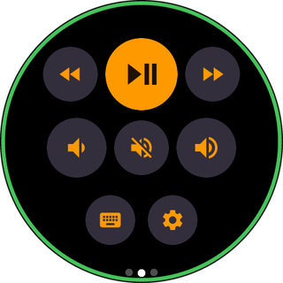
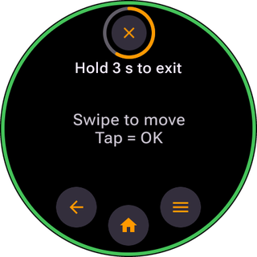
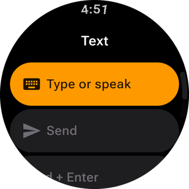
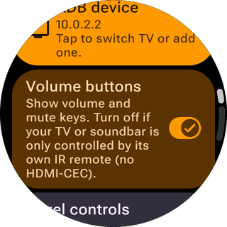
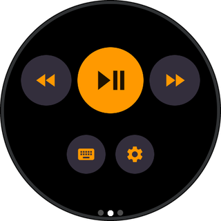
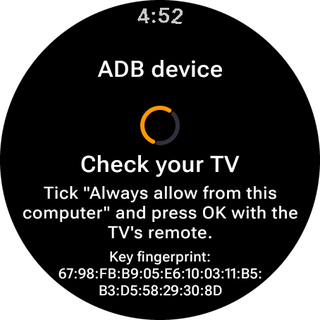
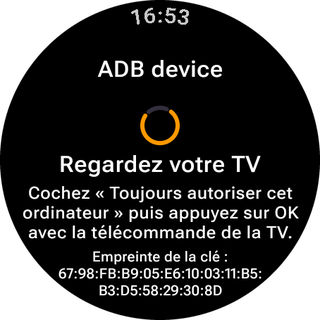
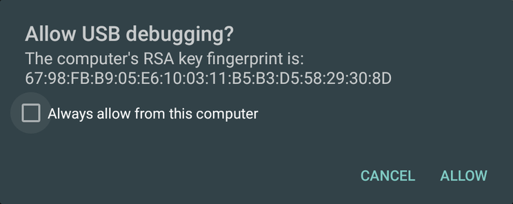

# Fire TV Remote for Wear OS

A standalone Wear OS app (built for the Samsung Galaxy Watch 9 on Wear OS 7) that controls an
Amazon **Fire OS** Fire TV over the local network using **ADB over TCP**. It doesn't need a
phone app, a cloud service or any telemetry.

<p align="center">
  
  
  
</p>
<p align="center">
  
  
  
  
</p>
<p align="center"><sub>Screenshots from the Wear OS 7 emulator controlling an Android TV 11 emulator (the Fire OS 8 base).</sub></p>

| Feature | Notes |
|---|---|
| D-pad, OK, Back, Home, Menu | Page 1. Shortcut keys sit in the grid corners |
| Play/Pause, Rewind, Fast-forward, Volume ±, Mute | Page 2. Volume only works over HDMI-CEC (see limitations). If your TV's sound is IR-only, turn off **Volume buttons** in Settings: the volume keys disappear and the bezel never changes the volume |
| Back gesture | Back (edge swipe or the watch's Back button) goes to the previous page and never closes the remote; leave with the Home button. **Swipe back can close the app** in Settings restores the usual behaviour |
| App launcher | Page 3. User-installed apps plus popular preinstalled streaming apps (Netflix, Prime Video, YouTube…); other system apps are hidden. Real icons and names (in the TV's language), read from the TV and cached on the watch. Both favourites and other apps are sorted by name. Long-press to pin a favourite |
| Languages | English and French. Follows the watch language, or set it per app in *Settings → Apps → Fire TV Remote → Language* (Wear OS 4+) |
| Bezel / crown | Moves up/down, or controls volume (toggle in Settings). Always volume on page 2, unless volume control is off |
| Settings | Every setting has a short explanation under its name |
| Wake TV | *Wake TV* (Settings) and **Wake TV on launch** (on by default): sends WAKEUP, checks with `dumpsys power`, and sends POWER only if the Fire TV is verifiably still asleep |
| Screen | **Keep screen on in the remote** (on by default): while the remote or touchpad shows, the screen doesn't turn off. After the **watch's own screen timeout** it dims to **Dimmed brightness** (10-100 %, default 30 %) by darkening the picture, which saves power on the AMOLED screen and works on every watch. The first touch or bezel turn only brightens it again. After **5 minutes** without any touch, bezel or key, the screen is no longer held on and turns off as usual (the connection and Wi-Fi are then released). Other screens keep the normal timeout |
| Touchpad mode | Swipe = direction, tap = OK, hold = Back. Open it from the bottom-right corner key |
| Text input | Watch keyboard / voice → focused text field on the TV (ASCII only) |
| Tile | Back, Play/Pause, Home sent straight from the tile; plus an "open remote" button |
| Complication | Opens the remote from the watch face |
| Haptics, connection ring | Ring colours: green = connected, amber = connecting, red = error, grey = idle |
| Discovery | mDNS (`_amzn-wplay._tcp`) plus a /24 scan of port 5555; manual IP as fallback |

## 1. Prepare the Fire TV (one time)

1. Check it runs **Fire OS**: *Settings → My Fire TV → About*. If the software version reads
   "OS 1.x", it's **Vega OS** (e.g. Fire TV Stick 4K Select). Vega has no ADB, so **this app
   can't work with it**.
2. Turn on developer options: *Settings → My Fire TV → About*, then click the device name
   **7 times**.
3. *Settings → My Fire TV → Developer options → **ADB debugging: ON***.
4. Write down the TV's IP address: *About → Network*.
5. Keep the **TV's own remote** nearby. The first connection shows *"Allow USB debugging?"* on
   the TV. Tick **Always allow from this computer** and press **OK**. The watch can't answer
   this prompt for you, because it isn't authorized yet.

## 2. Build

You need JDK 21 and the Android SDK with platform `android-37.0` and build-tools 37.0.0
(Android Studio installs both). Then run:

```bash
./gradlew :wear:assembleDebug
```

Other useful tasks:

```bash
./gradlew test                  # unit + Robolectric UI tests for every module
./gradlew :wear:lintDebug
./gradlew :wear:assembleRelease # minified; signed with the debug key for sideloading
```

> Toolchain used during development (no root needed): JDK and SDK under `~/.local/android-dev`.
> Run Gradle with `JAVA_HOME=~/.local/android-dev/jdk`. `local.properties` points to that SDK;
> change `sdk.dir` if yours lives somewhere else.

## 3. Install on the watch (ADB over Wi-Fi)

1. On the watch: *Settings → About watch → Software information → tap **Software version***
   until the watch says developer mode is on. Menu names vary slightly between One UI
   Watch releases.
2. *Settings → Developer options → **ADB debugging** ON*, then **Wireless debugging** ON.
   Make sure the watch is on the same Wi-Fi as the computer.
3. In *Wireless debugging → Pair new device*, the watch shows an IP:port and a code. Then run:

```bash
adb pair WATCH_IP:PAIR_PORT
```

```bash
adb connect WATCH_IP:CONNECT_PORT
```

```bash
adb install -r FireTVRemote-wear-<version>.apk
```

**WSL2 note:** WSL's default NAT network can't reach the watch. Either turn on mirrored
networking (`networkingMode=mirrored` in `%UserProfile%\.wslconfig`) or run Windows'
`adb.exe` (platform-tools for Windows) on the APK.

## 4. First run

1. Open **Fire TV Remote** and allow **local network** access. This is a runtime permission
   on Wear OS 7.
2. Tap **Find Fire TV**. Pick the TV from the list, or tap **Enter IP address**.
3. Accept the prompt on the TV (see §1.5). The watch shows the key fingerprint so you can
   compare it with the one the TV displays.
4. Use the remote: swipe left for media keys, then again for apps.

<p align="center">
  
  
  
</p>
<p align="center">
  
</p>
<p align="center"><sub>The fingerprint on the watch must match the one on the TV. Tick "Always allow", then Allow.</sub></p>

## Architecture

```
:wear     Compose for Wear OS UI, ViewModels, Tile, complication, AppContainer (manual DI)
:data     dadb transport, Keystore-wrapped ADB key, Wi-Fi network gate, NSD + subnet scan, DataStore
:domain   Pure Kotlin: models, ShellCommandBuilder, ShellFireTvConnection, RemoteSession
:testing  Fakes: FakeFireTvConnection, FakeShellTransport, FakeNetworkGate, in-memory repos
```

How a key press travels:

```
UI → RemoteViewModel → RemoteSession (queue, coalesce bursts, connect-on-demand, idle release, backoff)
   → ShellFireTvConnection (probe, timeout, state machine) → DadbShellTransport → TCP 5555 → Fire TV
```

- **Connection.** One authenticated ADB connection is kept open while in use.
- **Fast keys (on-TV injector).** After connecting, the watch pushes a ~4 KB helper
  (`wear/src/injector/`, compiled to `injector.dex` by Gradle) to the TV and starts it with
  `app_process` as the ADB shell user. Each key press is then one line on its stdin
  (`K 19 19`), answered with `OK`: about **10–15 ms** instead of ~500 ms per `input keyevent`
  on Android ≤ 11. It also answers `I <package>` with the app's label and icon (PNG, base64):
  it reads the app's own resources from its APK, without needing a Context. Old versions of
  the helper are deleted when a new one is pushed.
  - **Where it lives:** a private directory, `/data/local/tmp/firetvonwatch` (mode 0700),
    together with its ART cache (`ANDROID_DATA`).
  - **Integrity:** the file is checked against its SHA-256 before every start and pushed
    again if it differs. It's made read-only (0644).
  - **Lifetime:** it exits when the connection closes.
- **Fallback.** Until the injector is ready, or if it fails or stops answering (1.5 s), keys go
  through a short-lived shell running `cmd input keyevent …` (`input` on old Fire OS). Text
  and app launches always use this path. A burst of key presses goes out in **one** call.
- **Wi-Fi.** `ConnectivityManager.requestNetwork(TRANSPORT_WIFI)` plus `bindProcessToNetwork`,
  so traffic doesn't go through the phone's Bluetooth proxy. The request is released together
  with the connection.
- **Battery.** The connection and Wi-Fi request are dropped as soon as the app leaves the
  foreground, or after the idle timeout (30 s to 5 min, default 60 s). They reconnect on the
  next key press.
- **Key security.** RSA-2048 ADB key. The private key is stored AES-256-GCM encrypted with a
  non-exportable Android Keystore key, in `noBackupFilesDir`. Backups are turned off. *Settings
  → Reset watch key* creates a new identity.

| Library | Version | License | Why |
|---|---|---|---|
| dev.mobile:dadb | 2.0.0 | Apache-2.0 | Pure-JVM ADB client (no adb binary or server) |
| androidx.wear.compose (material3, foundation, navigation) | 1.7.1 | Apache-2.0 | Round-screen UI |
| androidx.navigation:navigation-compose | 2.10.2 | Apache-2.0 | Back-stack state for the Wear nav host |
| androidx.wear.tiles / protolayout | 1.6.2 / 1.4.2 | Apache-2.0 | Tile |
| androidx.wear.watchface complications-data-source-ktx | 1.3.0 | Apache-2.0 | Complication |
| androidx.wear:wear-input | 1.2.0 | Apache-2.0 | System keyboard/voice input |
| androidx.datastore:datastore-preferences | 1.3.0 | Apache-2.0 | Paired devices and settings |
| kotlinx-coroutines | 1.11.0 | Apache-2.0 | Concurrency |
| Test: JUnit 4, Robolectric 4.18, Compose UI test, Turbine, coroutines-test | – | EPL/MIT/Apache | Tests |

Build: AGP 9.5.1, Kotlin 2.4.21, Gradle 9.9.1, compile/target SDK 37, min SDK 34.

## Tests

`./gradlew test` runs **95 tests**:

- **domain (59):**
  - Command building: key batching, text escaping including `%s`, quotes and shell
    metacharacters, package validation.
  - Probe parsing.
  - Connection state machine: auth hint, refused, hang → timeout → close.
  - Session: coalescing, idle release, background release, reconnect-and-resend, backoff,
    no-retry on auth rejection, NO_WIFI, device switching.
  - Discovery merging and codecs.
  - Injector: pushed and used, not re-pushed when the hash matches, failed start → fallback,
    hung injector → dropped and the key resent, stopped on disconnect, safe start command.
- **data (11):**
  - ADB public-key encoding is **byte-identical to dadb's AOSP-format output**.
  - Key store persistence, encryption and regeneration.
  - Refused vs unreachable mapping using a real closed socket.
  - Subnet candidates.
  - Legacy (pre-Android 7) shell: exit-code marker parsing, pty echo filtering.
  - App label/icon disk cache.
- **wear (24):**
  - Screen: kept on only on the remote and touchpad; dims after the watch timeout; the waking touch presses nothing.
  - Rotary step accumulation, gesture classification, tile actions.
  - Robolectric Compose tests of the real screens against the fake Fire TV: OK sends
    SELECT; labelled keys; swipe to the media page; refused error → guidance → retry;
    touchpad swipe and tap; the whole UI in French; the connection-state node doesn't
    cover the buttons (TalkBack regression); back goes to the previous page and never closes
    the remote unless allowed; back leaves the touchpad and Settings; the media page
    without volume keys.

### Emulator end-to-end run (2026-11-15)

Setup: Wear OS 7 emulator (API 37) as the watch, Android TV 11 emulator (API 30, the
Android version Fire OS 8 is based on, `ro.adb.secure=1`, TCP ADB mode) as the TV.

| Step | Result |
|---|---|
| `ACCESS_LOCAL_NETWORK` runtime prompt (shown as "Nearby devices") | ✅ granted via the real system dialog |
| App-level Wi-Fi `requestNetwork` + subnet scan | ✅ TV found; the watch's own address is now excluded |
| ADB RSA handshake → "Allow USB debugging?" on TV | ✅ fingerprint on TV **matches** the watch's |
| Prompt ignored/denied → watch shows "No answer from the TV" + Retry after 45 s | ✅ |
| "Always allow" + Allow → watch shows "Connected!" | ✅ |
| D-pad from the watch moves focus on the TV | ✅ |
| Latency per command, before the injector | ❌ 507 ms: Android 11 has no `cmd input`, so each `input keyevent` starts a JVM |
| **Latency per command, with the injector** | ✅ **10–14 ms** (Settings shows "fast input") |
| Injector killed mid-session → next key falls back to `input` and still works | ✅ |
| Injector stored in a 0700 directory, file 0644, hash-checked (not re-pushed when unchanged) | ✅ |
| "Always allow" survives a reconnect | ⚠️ not on this emulator image: it saves the key but never writes it to `adb_keys`. A plain host-side dadb client shows the same thing, so it's the emulator, not the app. Check on a real Fire TV |
| Manual IP entry via the system keyboard | ⚠️ couldn't be automated (the emulator IME ignores injected text); to verify by hand |

## Manual test checklist (real watch + Fire TV)

These can't be checked without hardware:

- [ ] First connection: the TV prompt appears, the fingerprint matches, "Always allow" → Connected.
- [ ] Latency: watch *Settings* should show "fast input" and *Last command: N ms*. Target < 150 ms. Report the values you see.
- [ ] Reconnect after the idle timeout does **not** show the TV prompt again (after "Always allow").
- [ ] Every key on pages 1 and 2 does the right thing. Volume/mute with your TV/soundbar over CEC.
- [ ] Bezel: exactly one focus step per detent; clockwise = down / volume up (tell me if it should be reversed).
- [ ] Touchpad: swipes in 4 directions, tap = OK, hold = Back; doesn't close the screen by accident.
- [ ] Text: Fire TV search field ← "stranger things"; voice input; "Send + Enter".
- [ ] Apps page lists your apps; launching Netflix / Prime Video / YouTube works.
- [ ] Discovery finds the TV by mDNS (by name) and/or scan (as "ADB device").
- [ ] With the phone connected over Bluetooth: the app still connects (Wi-Fi comes up on its own).
- [ ] Turn TV Wi-Fi off and on, or reboot the TV → the app reconnects on the next press.
- [ ] Leave the app 60 s → ring turns grey (disconnected); next press reconnects.
- [ ] Tile: Play/Pause works without opening the app; complication opens the remote.
- [ ] Sleep / Wake from Settings.
- [ ] TalkBack reads every button.
- [ ] Battery: 30 min of mixed use; note the % drop.

## Troubleshooting

| Message on the watch | Fix |
|---|---|
| Watch Wi-Fi unavailable | Turn on Wi-Fi on the watch and join the TV's network. Turn off airplane / power-saving mode |
| TV not reachable | Check the IP (*TV → About → Network*). TV awake? Same network (no guest Wi-Fi / client isolation)? |
| Connection refused | ADB debugging is off on the TV. Turn it on again (Fire OS updates sometimes switch it off) |
| No answer from the TV | The prompt timed out (45 s) or nobody saw it. Retry while watching the TV |
| The TV refused the connection | "Allow" wasn't chosen. Retry and allow. If you ticked "Always allow" earlier, *Developer options → Revoke USB debugging authorizations* on the TV resets it |
| Failed: Only plain ASCII text… | `input text` can't type accents or emoji |
| Discovery finds nothing | Use **Enter IP address**. mDNS is often blocked on mesh / enterprise Wi-Fi |
| Volume / mute keys do nothing | Your TV or soundbar isn't controlled over HDMI-CEC (common on older TVs with IR remotes). Turn off *Settings → Volume buttons* |
| The app closes when swiping right | Turn off *Settings → Swipe back can close the app* (off by default) |
| The Fire TV wakes but the TV screen stays black | The Fire TV turns the TV on through HDMI-CEC. Turn it on on both: Fire TV *Settings → Display & Sounds → HDMI CEC Device Control*, and on the TV (Samsung: *Anynet+ (HDMI-CEC)*). Older TVs without CEC have to be switched on with their own remote |
| "The Fire TV is still asleep" | The Fire TV ignored both WAKEUP and POWER, or is in a deep sleep that drops the network. Wake it once with its remote |

## Fire OS compatibility

| Fire OS | Android | Status |
|---|---|---|
| **8.x** (e.g. 8.1.8.5) | 11 (API 30) | **Primary target.** Emulator-verified end to end: pairing, keys via injector (10–14 ms), app list, app launch, fallback |
| 7.x | 9 (API 28) | Same code path as Fire OS 8 (shell v2, no `cmd input` → injector). Not run on an emulator |
| 6.x | 7.1 (API 25) | Same path. Not run on an emulator |
| 5.x | 5.1 (API 22) | No shell v2 in adbd: the app falls back to the legacy `shell:` service (exit-code marker, pty echo filtering), and the commands avoid tools missing there (`cmd`, `grep`, `tail`, `cut`, `sha256sum`). Unit-tested only |
| Vega OS | – | Not supported (no ADB) |

## Known limitations

- **Vega OS Fire TVs are not supported** (no consumer ADB).
- **The fast-input injector uses an internal Android method** (`InputManager(Global).injectInputEvent`,
  the same one scrcpy uses). If a Fire OS update blocks it, the app falls back to `input`
  on its own (~0.5 s per command on Android ≤ 11, faster on 13+ with `cmd input`).
- **Volume/mute** go through HDMI-CEC only. IR-controlled TVs and soundbars won't react, and
  the current volume can't be read.
- **Text** is ASCII-only, and the TV must have a text field focused.
- **Wake** may not work from deep sleep, if the TV turns its network off.
- **Cold tap latency.** The first press after idle has to reconnect (Wi-Fi up + TCP + ADB
  handshake). Expect ~1–3 s, mostly waiting for Wi-Fi.
- **Tile** presses run in the background; if Wear OS limits background network for the app,
  they may fail. Use "open remote" in that case.
- Discovery lists any device with network ADB on, not only Fire TVs.
- **Not verified on hardware:** the mDNS service name `_amzn-wplay._tcp`, its TXT "n" name
  field, and the bezel pixels-per-detent value all need checking against the manual checklist.

## Suggested next steps

1. Run the manual checklist above and send me the latency numbers and anything off.
2. Tune bezel sensitivity and direction from your results.
3. Optional: Unicode text via an IME installed on the TV (e.g. ADBKeyboard), long-press keys
   (`keyevent --longpress`) for fast seek, a Wear OS 7 widget.
4. Optional: research spike on the Fire TV app's own protocol, if Vega support matters.
